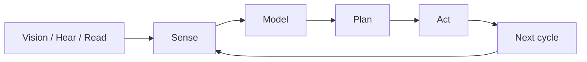

# SMPA-ROS

SMPA (**Sense → Model → Plan → Act**) is an experimental robot-cognition system
for ROS 2. It combines language-model inference with camera, speech and textual
observations, a persistent world model, constrained action selection, and ROS
execution. It is research software; model output is evidence to inspect, not a
guarantee that the robot understands its environment.

## Architecture



- **Sense** acquires observations and saves their evidence and provenance.
  Vision uses a camera and VLM; Hear records and transcribes microphone input;
  Read observes new User messages in an explicitly selected conversation.
- **Model** produces a complete Markdown world-model snapshot using observations
  and the previous snapshot.
- **Plan** selects an enabled action under a JSON schema, using the world model
  and goal. The default action set is `look_left` / `look_right`.
- **Act** validates and dispatches the selected action, then records its outcome.
  The explicit stage order is in [smpa_ros/smpa.py](smpa_ros/smpa.py);
  [runner.py](runner.py) supplies the runtime and persistence wiring.

The independent conversational application follows **Sense → Model → Act**:
receive a message, update attributed RDF beliefs, and generate a response.
Its RDF does not replace the robot's Markdown world model. Read does not invoke
conversation inference or RDF updates; its consumption cursor belongs to each
robot run and advances only when the Sense record is successfully persisted.

## Requirements

- **Ubuntu 24.04, ROS 2 Jazzy, system Python 3.12**, and `colcon`.
  The installer explicitly checks this platform.
- Internet access for initial Python packages and model downloads; sufficient
  disk and RAM for the selected weights. The default is
  **Qwen/Qwen3-VL-2B-Instruct**. CPU inference is supported but can be slow;
  CUDA requires a compatible NVIDIA driver and PyTorch installation.
- For the default robot experiment: an external camera publishing
  `/tiago/camera/color/image_raw` and compatible `simulation_actions/Look`
  servers at `/look_left` and `/look_right`.
- Hear needs PortAudio, a working microphone and local Whisper weights. Speech
  participants also require the configured Piper voice. Neither downloads
  weights at startup.

## Installation

Install [ROS 2 Jazzy](https://docs.ros.org/en/jazzy/Installation/Ubuntu-Install-Debs.html)
first. From a fresh terminal, without a stale repository-level ROS overlay:

```bash
sudo apt update
sudo apt install git build-essential python3-venv python3-pip \
  python3-colcon-common-extensions libportaudio2 ros-jazzy-rclpy \
  ros-jazzy-sensor-msgs ros-jazzy-action-msgs ros-jazzy-launch-ros \
  ros-jazzy-ament-cmake ros-jazzy-ament-cmake-python \
  ros-jazzy-rosidl-default-generators ros-jazzy-rqt-graph
mkdir -p ~/ros2_ws/src
cd ~/ros2_ws/src
# Skip either clone if that checkout already exists.
git clone --branch master https://github.com/Dorteel/webots_ros2_simulation.git
git clone https://github.com/Dorteel/smpa-ros.git
cd smpa-ros
./install.sh
```

[install.sh](install.sh) creates `.venv`, installs the declared inference/speech
packages, provisions the shared model selected in [config.yaml](config.yaml),
and builds SMPA plus the external `simulation_actions` interfaces into
`~/ros2_ws/install`. It does **not** install or start Webots. Re-run it after
source or installed-asset changes. Explicit model paths must already be complete
or match the downloader layout; model definitions are in [models/](models/).

The [external simulation repository](https://github.com/Dorteel/webots_ros2_simulation)
requires its own installation and launch procedure (the inspected integration
used Webots R2025a with the full camera/head profile). Keep its simulation
stepping and use the same ROS domain as SMPA. Other camera/action servers must
provide the same interfaces. The launcher currently checks the Webots `Look`
interface even for nonphysical experiments.

## Quick Start

Run these commands from the `smpa-ros` root after installation.

**Standard robot pipeline** — requires the camera, selected model and external
Look action servers. This command can move the simulated robot's head:

```bash
./run_smpa.sh max_cycles:=1
```

The launcher defaults to Vision and one cycle. Configure the shared backend,
goal, generation settings and action schema in [config.yaml](config.yaml).
It never builds, downloads models or starts a simulator. Runs are saved under
`memory/runs/<timestamp_name_uuid>/`: camera/audio evidence in `observations/`,
world snapshots in `world_model/`, stage records in `state/`, and lifecycle
information in `metadata.yaml`.

**Hear + Read + Vision** — first provision the speech assets:

```bash
.venv/bin/python -c "from huggingface_hub import snapshot_download; snapshot_download('Systran/faster-whisper-base', local_dir='models/speech/faster-whisper-base', allow_patterns=['model.bin', '*.json', 'vocabulary.*'])"
.venv/bin/python -m piper.download_voices en_US-lessac-medium --download-dir models/speech/piper
```

Then select a real conversation run containing `metadata.yaml` and
`conversation.md`; replace the example path below. The Observe-only profile
runs all four stages without sending movement goals. It still needs camera
frames, local models, a microphone, and speech during the capture interval.

```bash
./run_smpa.sh --all-senses /absolute/path/to/conversation/run \
  config:="$PWD/config/sense_observe.yaml" max_cycles:=1 timeout:=240
```

Read is non-blocking and incremental; an empty conversation contributes no new
messages. It never writes to the source session. Hear silence is an observation
error, not a successful empty transcript. See the focused
[Read tests](test/test_read.py) and [all-senses acceptance test](test/test_sense_pipeline_integration.py).

**Conversational application** — independent of ROS execution and the simulator:

```bash
.venv/bin/python scripts/download_models.py --model qwen3-4b
.venv/bin/python -m smpa_ros.conversation_web --config "$PWD/config.yaml"
```

Open `http://127.0.0.1:8000`. The current conversational defaults use Qwen3-4B
for responding and belief modelling. The application creates its own session;
`--resume /absolute/path/to/conversation/run` resumes one. Its model selection is
independent of the robot's shared VLM.

**Tests and ROS inspection:**

```bash
./test.sh --unit
./test.sh --integration
./test.sh --rlhf
source /opt/ros/jazzy/setup.bash
source ../../install/setup.bash
rqt_graph
```

Unit tests build an isolated ROS overlay and check installed assets/entry points.
Integration tests need the intended local models and optional dependencies;
the all-senses test uses controlled camera/audio fixtures and Observe-only
execution. RLHF tests require the separate `.venv-rlhf` environment.
`rqt_graph` needs its Qt display and a running system in the same ROS domain;
it shows ROS communication, not Python calls inside Runner or file-backed Read.

## Repository Structure

```text
runner.py, smpa_ros/smpa.py   Runtime and explicit robot stage sequence
sense/{hear,read,vision}/    Sensory acquisition and evidence handling
smpa_ros/                   Model, Plan, Act, conversation, RDF and backends
speech/                     Listen/Talk ROS actions and audio backends
smpa_ros_interfaces/        Custom ROS services and actions
launch/, config/, models/   Launch descriptions, profiles and model registry
memory.py, memory/          Run persistence and local execution records
gui/                        Independent observational ROS browser GUI (v1 on main)
rlhf_gym/, tests_rlhf/       Separate feedback/training laboratory
test/, test.sh              Robot, conversation and auxiliary-tool tests
```

## Current Capabilities

- ROS sensing with timestamped camera evidence saved before VLM inference,
  audio/transcript persistence, and recoverable per-run conversation consumption.
- Local Transformers inference and API-backed text/vision inference through
  configured OpenAI or Nebula endpoints. API use requires credentials and endpoint
  access; advertised response formats depend on the provider. The default robot
  loop shares one inference backend across its cognitive stages.
- Markdown world snapshots, schema-constrained planning, action validation,
  ROS goal/result handling, and persistent stage provenance.
- Role-preserving conversations, resumption, validated atomic RDF belief updates,
  statement attribution, and browser graph inspection. Conversational claims
  remain attributed statements, not verified physical facts.
- Independent text-guided segmentation and **VisualJEV** forced-choice visual
  evaluation with probability outputs and a ROS service. They have their own
  model/dependency requirements and tests; neither replaces Model/Plan or runs
  automatically in the standard loop. See the model registry and
  [VisualJEV dependency declaration](requirements-visual-jev.txt).

Advanced references: [observational GUI guide](gui/README.md),
[RLHF architecture](ARCHITECTURE.md), [training guide](TRAINING.md), and
[RLHF limitations](TODO.md). The previous
[detailed README](https://github.com/Dorteel/smpa-ros/blob/7f6b3c07c37516a0192f913d8ae4d83aa107e055/README.md)
preserves API examples, auxiliary-tool setup and experiment notes; it is a
historical reference and contains superseded commands. Current scripts and
configuration take precedence (speech requirements are at
`speech/requirements-speech.txt`).

## Under Development

**Implemented but experimental:** the independent RLHF gym supports feedback,
explicitly approved SFT/DPO training and adapter checkpoints; it is not an online
robot-learning stage. See the linked training and limitations documents for its
separate environment and verification boundaries. Optional browser, GPU and
provider-specific inference checks depend on available tooling and hardware;
fixture tests do not establish physical robot safety or model reasoning quality.

**GUI integration:** `main` includes the observational GUI v1. Actions v2 and the
read-only Sense workspace v3 have been integrated on the separate local
`integration/gui-v3-sense` worktree branch, not merged into `main`. Their browser
verification remains incomplete. The four-quadrant SMPA dashboard is unfinished.

**Planned or incomplete:** an RDF Sense Graph and central I-Graph, causal planning,
richer action representations, and Physical/Mental mode integration. Existing
conversational RDF and schema-constrained single-action selection do not implement
these broader designs.
