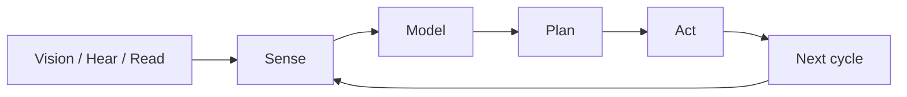

# SMPA-ROS

SMPA (**Sense → Model → Plan → Act**) is an experimental robot-cognition system
for ROS 2. It combines language-model inference with camera, speech and textual
observations, a persistent world model, constrained action selection, and ROS
execution. It is research software; model output is evidence to inspect, not a
guarantee that the robot understands its environment.

## Architecture



- **Sense** acquires observations and saves their evidence and provenance.
  Vision uses a camera and VLM; Hear records and transcribes microphone input;
  Read observes new User messages in an explicitly selected conversation.
- **Model** produces a complete Markdown world-model snapshot using observations
  and the previous snapshot.
- **Plan** selects an enabled action under a JSON schema, using the world model
  and goal. The default action set is `look_left` / `look_right`.
- **Act** validates and dispatches the selected action, then records its outcome.
  The explicit stage order is in [smpa_ros/smpa_ros/smpa.py](smpa_ros/smpa_ros/smpa.py);
  [runner.py](runner.py) supplies the runtime and persistence wiring.

The independent conversational application follows **Sense → Model → Act**:
receive a message, update attributed RDF beliefs, and generate a response.
Its RDF does not replace the robot's Markdown world model. Read does not invoke
conversation inference or RDF updates; its consumption cursor belongs to each
robot run and advances only when the Sense record is successfully persisted.

## Requirements

- **Ubuntu 24.04, ROS 2 Jazzy, system Python 3.12**, and `colcon`.
  The installer explicitly checks this platform.
- Internet access for initial Python packages and model downloads; sufficient
  disk and RAM for the selected weights. The default is
  **Qwen/Qwen3-VL-2B-Instruct**. CPU inference is supported but can be slow;
  CUDA requires a compatible NVIDIA driver and PyTorch installation.
- For the default robot experiment: an external camera publishing
  `/tiago/camera/color/image_raw` and compatible `simulation_actions/Look`
  servers at `/look_left` and `/look_right`.
- Hear needs PortAudio, a working microphone and local Whisper weights. Speech
  participants also require the configured Piper voice. Neither downloads
  weights at startup.

## Installation

Install [ROS 2 Jazzy](https://docs.ros.org/en/jazzy/Installation/Ubuntu-Install-Debs.html)
first. From a fresh terminal, without a stale repository-level ROS overlay:

```bash
sudo apt update
sudo apt install git build-essential python3-venv python3-pip \
  python3-colcon-common-extensions libportaudio2 ros-jazzy-rclpy \
  ros-jazzy-sensor-msgs ros-jazzy-action-msgs ros-jazzy-launch-ros \
  ros-jazzy-ament-cmake ros-jazzy-ament-cmake-python \
  ros-jazzy-rosidl-default-generators ros-jazzy-rqt-graph
mkdir -p ~/ros2_ws/src
cd ~/ros2_ws/src
# Skip either clone if that checkout already exists.
git clone --branch master https://github.com/Dorteel/webots_ros2_simulation.git
git clone https://github.com/Dorteel/smpa-ros.git
cd smpa-ros
./install.sh
```

[install.sh](install.sh) creates `.venv`, installs the declared inference/speech
packages, provisions the shared model selected in [config.yaml](config.yaml),
and builds SMPA plus the external `simulation_actions` interfaces into
`~/ros2_ws/install`. It does **not** install or start Webots. Re-run it after
source or installed-asset changes. Explicit model paths must already be complete
or match the downloader layout; model definitions are owned by [smpa_llm/models/](smpa_llm/models/).

The [external simulation repository](https://github.com/Dorteel/webots_ros2_simulation)
requires its own installation and launch procedure (the inspected integration
used Webots R2025a with the full camera/head profile). Keep its simulation
stepping and use the same ROS domain as SMPA. Other camera/action servers must
provide the same interfaces. The launcher currently checks the Webots `Look`
interface even for nonphysical experiments.

## Package configuration

`smpa_ros` owns cognitive settings and ROS adapters; `smpa_llm` owns inference,
model provisioning and independent training. Their primary defaults are
[smpa_ros/config.yaml](smpa_ros/config.yaml) and
[smpa_llm/config.yaml](smpa_llm/config.yaml), installed in their ROS share
resources. The cognitive file explicitly selects the shared inference defaults;
explicit top-level overrides replace entire sections, matching legacy behavior.
The interface package contains contracts only and has no configuration file.

The complete root [config.yaml](config.yaml) remains a **legacy compatibility
configuration**, used by `run_smpa.sh` and the existing configurator. It is read
as a complete configuration instead of the package preset; existing model
selections and commands remain unchanged. Inspect the existing ROS launch
command, which selects package defaults unless overridden:

```bash
source /opt/ros/jazzy/setup.bash
source ../../install/setup.bash
ros2 launch smpa_ros llm.launch.py --show-args
```

Keep writable experiment overrides outside installed share directories and pass
`config:=/absolute/path/to/config.yaml`. Credentials remain in environment
variables or an external `.env`. See the
[migration and dependency map](docs/architecture/llm-reorganization.md).

## Quick Start

Run these commands from the `smpa-ros` root after installation.

**Standard robot pipeline** — requires the camera, selected model and external
Look action servers. This command can move the simulated robot's head:

```bash
./run_smpa.sh max_cycles:=1
```

The launcher defaults to Vision and one cycle. Configure the shared backend,
goal, generation settings and action schema in [config.yaml](config.yaml).
It never builds, downloads models or starts a simulator. Runs are saved under
`memory/runs/<timestamp_name_uuid>/`: camera/audio evidence in `observations/`,
world snapshots in `world_model/`, stage records in `state/`, and lifecycle
information in `metadata.yaml`.

**Hear + Read + Vision** — first provision the speech assets:

```bash
.venv/bin/python -c "from huggingface_hub import snapshot_download; snapshot_download('Systran/faster-whisper-base', local_dir='models/speech/faster-whisper-base', allow_patterns=['model.bin', '*.json', 'vocabulary.*'])"
.venv/bin/python -m piper.download_voices en_US-lessac-medium --download-dir models/speech/piper
```

Then select a real conversation run containing `metadata.yaml` and
`conversation.md`; replace the example path below. The Observe-only profile
runs all four stages without sending movement goals. It still needs camera
frames, local models, a microphone, and speech during the capture interval.

```bash
./run_smpa.sh --all-senses /absolute/path/to/conversation/run \
  config:="$PWD/config/sense_observe.yaml" max_cycles:=1 timeout:=240
```

Read is non-blocking and incremental; an empty conversation contributes no new
messages. It never writes to the source session. Hear silence is an observation
error, not a successful empty transcript. See the focused
[Read tests](test/test_read.py) and [all-senses acceptance test](test/test_sense_pipeline_integration.py).

**Conversational application** — independent of ROS execution and the simulator:

```bash
.venv/bin/python scripts/download_models.py --model qwen3-4b
source ../../install/setup.bash
.venv/bin/python -m smpa_ros.conversation_web --config "$PWD/config.yaml"
```

Open `http://127.0.0.1:8000`. The current conversational defaults use Qwen3-4B
for responding and belief modelling. The application creates its own session;
`--resume /absolute/path/to/conversation/run` resumes one. Its model selection is
independent of the robot's shared VLM.

**ROS browser GUI** — the consolidated `gui/` includes ROS graph and sensor
inspection, Actions v2, and the read-only SMPA Sense workspace v3. Install its
separate environment and launch from the repository root:

```bash
./gui/install_gui.sh --dev
./gui/run_gui.sh --read-only --memory-root "$PWD/memory"
```

Open `http://127.0.0.1:8765`. The GUI runs independently of the cognitive loop
and can inspect ROS without SMPA running. Recorded Sense evidence comes from
the selected memory directory; live sensors require publishers in the same ROS
domain. The launcher discovers the enclosing workspace overlay for custom types.
`--read-only` disables action execution; omit it to enable explicit, confirmed
action requests. The Sense workspace does not submit conversation messages or
start robot runs. See the [GUI guide](gui/README.md), [API](gui/API.md), and
[SMPA data contracts](gui/SMPA_CONTRACTS.md).

**Tests and ROS inspection:**

```bash
./test.sh --unit
./test.sh --integration
./test.sh --rlhf
./gui/test_gui.sh --browser
source /opt/ros/jazzy/setup.bash
source ../../install/setup.bash
rqt_graph
```

Unit tests build an isolated ROS overlay and check installed assets/entry points.
Integration tests need the intended local models and optional dependencies;
the all-senses test uses controlled camera/audio fixtures and Observe-only
execution. RLHF tests require the separate `.venv-rlhf` environment.
GUI tests use isolated ROS fixture nodes and action servers. Logic tests skip
without Node.js; browser tests skip without Playwright and require its Chromium
browser to be installed when Playwright is available.
`rqt_graph` needs its Qt display and a running system in the same ROS domain;
it shows ROS communication, not Python calls inside Runner or file-backed Read.

## Repository Structure

```text
smpa_ros/                   Cognitive ROS package: metadata, config and launch/
  smpa_ros/                 Model, Plan, Act, conversation, RDF and sensory service
  runner.py, memory.py      Orchestration and provenance; legacy imports retained
  sense/, speech/           Hear/Read/Vision and speech ROS adapters
smpa_llm/                   Shared inference ROS package; no inference server
  config.yaml, models/      Inference defaults and pinned model definitions
  smpa_llm/inference/       Engines, speech, segmentation and VisualJEV inference
  smpa_llm/models/          Local asset checks, selection and explicit provisioning
  smpa_llm/training/rlhf/    Independent feedback, SFT and DPO laboratory
smpa_ros_interfaces/        Existing ROS services and actions; no implementation
gui/                        Unchanged independent browser frontend/backend adapter
models/, memory/            Existing local weight paths and run records
config/                     Existing experiment profiles
test/, tests_rlhf/, test.sh Package, robot, conversation and training verification
```

## Current Capabilities

- ROS sensing with timestamped camera evidence saved before VLM inference,
  audio/transcript persistence, and recoverable per-run conversation consumption.
- Local Transformers inference and API-backed text/vision inference through
  configured OpenAI or Nebula endpoints. API use requires credentials and endpoint
  access; advertised response formats depend on the provider. The default robot
  loop shares one inference backend across its cognitive stages.
- Markdown world snapshots, schema-constrained planning, action validation,
  ROS goal/result handling, and persistent stage provenance.
- Role-preserving conversations, resumption, validated atomic RDF belief updates,
  statement attribution, and browser graph inspection. Conversational claims
  remain attributed statements, not verified physical facts.
- A self-contained ROS browser GUI with sensor streams, guarded action execution,
  and recorded Vision/Hear/Read observation browsing. Its HTTP/WebSocket gateway
  is separate from cognition and exposes documented interfaces for other frontends.
- Independent text-guided segmentation and **VisualJEV** forced-choice visual
  evaluation with probability outputs and a ROS service. They have their own
  model/dependency requirements and tests; neither replaces Model/Plan or runs
  automatically in the standard loop. See the model registry and
  [VisualJEV dependency declaration](requirements-visual-jev.txt).

Model provisioning also has an installed command:
`ros2 run smpa_llm download_models --list` (read-only inventory).
The existing `.venv/bin/python scripts/download_models.py ...` command remains
available. Weights and checkpoints have not moved. Source compatibility links and
legacy backend imports point to single implementations; source Python commands
for cognition require the built ROS overlay to be sourced.

Advanced references: [ROS GUI guide](gui/README.md),
[RLHF architecture](ARCHITECTURE.md), [training guide](TRAINING.md), and
[RLHF limitations](TODO.md). The previous
[detailed README](https://github.com/Dorteel/smpa-ros/blob/7f6b3c07c37516a0192f913d8ae4d83aa107e055/README.md)
preserves API examples, auxiliary-tool setup and experiment notes; it is a
historical reference and contains superseded commands. Current scripts and
configuration take precedence (speech requirements are at
`speech/requirements-speech.txt`).

## Under Development

**Implemented but experimental:** the independent RLHF gym supports feedback,
explicitly approved SFT/DPO training and adapter checkpoints; it is not an online
robot-learning stage. See the linked training and limitations documents for its
separate environment and verification boundaries. Optional browser, GPU and
provider-specific inference checks depend on available tooling and hardware;
fixture tests do not establish physical robot safety or model reasoning quality.

**GUI verification and remaining work:** GUI v1, Actions v2 and Sense v3 are
consolidated on `main`. Browser verification remains incomplete because
Playwright was unavailable during consolidation; five Node.js logic tests were
also skipped. One ROS CLI discovery check failed initially and passed on the
unchanged full rerun. The four-quadrant SMPA dashboard remains unfinished;
Model, Plan and Act sections in the SMPA tab are placeholders.

**Planned or incomplete:** an RDF Sense Graph and central I-Graph, causal planning,
richer action representations, and Physical/Mental mode integration. Existing
conversational RDF and schema-constrained single-action selection do not implement
these broader designs.


## Tier 1 ROS interfaces

The independent inference node is named `/llm`; the lifecycle node is named
`/smpa_control`. The following names assume the default ROS namespace. Names
are relative in the implementation and gain any namespace supplied at launch.
All types below belong to `smpa_ros_interfaces`; the inference endpoints are
implemented by `smpa_llm` and the SMPA endpoints by `smpa_ros`.

| ROS name | Type | Goal or request | Result or response | Feedback or behavior |
|---|---|---|---|---|
| `/llm/generate` | action `GenerateText` | `string prompt` | `string text` | `string partial_text`; generate text |
| `/llm/generate_structured` | action `GenerateStructured` | `string prompt`, `string json_schema` | `string json_output` | `string partial_text`; generate schema-constrained JSON |
| `/llm/describe_image` | action `DescribeImage` | `sensor_msgs/Image image`, `string prompt` | `string description` | `string partial_text`; describe the supplied image |
| `/llm/describe_structured_image` | action `DescribeStructuredImage` | `sensor_msgs/Image image`, `string prompt`, `string json_schema` | `string json_output` | `string partial_text`; describe the image with constrained JSON |
| `/llm/load_model` | action `LoadModel` | `string model_id` | `bool success`, `string error_message` | `string stage`; load a registered alias |
| `/llm/unload_model` | action `UnloadModel` | empty | `bool success`, `string error_message` | `string stage`; release the active backend |
| `/llm/set_active_model` | action `SetActiveModel` | `string model_id` | `bool success`, `string error_message` | `string stage`; select and load a registered alias |
| `/llm/list_models` | service `ListModels` | empty | `string[] model_ids` | List supported configured aliases |
| `/llm/get_model_status` | service `GetModelStatus` | empty | `string active_model`, `string state` | Return the current backend status |
| `/llm/inference_status` | topic `InferenceStatus` | — | `string state`, `string active_model` | Retained status published on transitions |
| `/smpa/start` | service `StartSmpa` | `string goal` | `bool accepted`, `string run_id` | Start one experiment child |
| `/smpa/stop` | service `StopSmpa` | empty | `bool accepted` | Request interruption of the child |
| `/smpa/get_status` | service `GetSmpaStatus` | empty | `string state`, `string run_id`, `string active_stage` | Return the latest observed lifecycle state |
| `/smpa/events` | topic `SmpaEvent` | — | `string run_id`, `string stage`, `string event` | Report observed run and stage transitions |

The legacy `Listen`, `Talk`, `DescribeScene`, `EvaluateVisualDecision`, and
`SegmentImage` definitions remain registered.
### Configuration and precedence

Each registered alias has its own `models.<alias>.*` ROS parameter namespace.
The loading settings are `model_id`, `path`, `backend`, `device`, `dtype`, and
`enable_thinking`; `max_new_tokens`, `temperature`, `top_p`, and `seed` are
request generation settings. A `seed` of `-1` leaves it unset. Setting a
loading field stages the new value; an explicit load or switch applies it.
Generation settings are snapshotted for each request, so subsequent parameter
changes do not change an operation already in progress. `active_model` names
the loaded alias and cannot be changed directly at runtime: use a model action.

The installed `smpa_llm/models/model_library.yaml` supplies registered defaults.
The `model` entry in installed `smpa_llm/config.yaml` overlays the selected
primary alias. ROS parameter overrides take precedence over those defaults.
`configuration_file`, `registry_file`, and `model_root` are read-only after
node creation and can be supplied as startup overrides. `active_model` is empty
by default; a startup override requests an initial load. The launch file reads
`params_file` first and a nonempty `active_model` launch argument takes
precedence over the value in that file. `use_sim_time` is the standard ROS
clock parameter. The catalogue lists compatible adapters with essential
configuration; it does not prove that assets or provider credentials exist.

For example, `qwen3-4b` is an alias in the installed registry:

```yaml
llm:
  ros__parameters:
    active_model: qwen3-4b
    models:
      qwen3-4b:
        model_id: Qwen/Qwen3-4B
        path: text/qwen3-4b
        backend: transformers
        device: auto
        dtype: auto
        enable_thinking: false
        max_new_tokens: 512
        temperature: 0.7
        top_p: 0.9
        seed: 42
```

Use a local checkpoint that is actually installed before selecting it. This
example changes generation defaults and does not download model weights.

### Operation and limitations

Both `load_model` and `set_active_model` currently load the selected alias;
with one active backend there is no distinct inactive loaded model. Repeating
an identical load reuses it. Switching releases the old backend before loading a replacement; if that
load fails, the server enters `error` with no active model. An unknown alias
is rejected before releasing the old model. An unload
releases the owned backend. Management and inference share one exclusive slot;
an overlapping action goal is rejected. The separate Runner still owns its
existing in-process inference path, so starting this server does not redirect it.

The adapter reuses existing Transformers text and vision implementations and
configured API providers. Specialized speech, segmentation, VisualJEV, and
remote model lifetime management are not offered by this server. Actual model
and provider capabilities, available weights, supported controls, and API
credentials determine whether a request succeeds. `json_schema` is the actual
serialized JSON Schema, not a path: structured requests use the existing
constrained generation path and validate its output. Unsupported schema
handling fails instead of falling back to unconstrained generation.

Inference result messages contain no error field: failed actions are aborted
and details are logged by the server. Management results include an error
message. The current blocking backends cannot cooperatively cancel or stream,
so cancellation is rejected and inference `partial_text` feedback is not
emitted. Model status values include `unloaded`, `loading`, `ready`,
`generating`, `unloading`, and `error`.

The lifecycle node reports `idle`, `running`, `stopping`, `completed`,
`interrupted`, or `failed`. It delegates to the existing Runner and experiment;
the experiment retains stage ordering and persisted records remain authoritative.
A start can fail while initializing; the service waits at most 30 seconds for
its initial notification before bounded child cleanup. Stop requests SIGINT and
then escalates if the child does not exit. Forced termination can prevent normal
final persistence. Lifecycle notifications are advisory.

The lifecycle node's read-only startup parameters are `configuration_file`
(installed `smpa_ros/config.yaml` by default), `memory_root` (`memory` under
the current directory), `model_root` (`models` under the current directory),
and `runner_arguments` (default `['--service', 'vision']`). Configure them at
node startup; the goal itself is a service request, not persistent configuration.

### ROS command examples

Source the ROS installation and the built workspace overlay first. Start the
independent server unloaded in one terminal:

```bash
ros2 launch smpa_llm server.launch.py
```

With the same overlay sourced in another terminal, inspect the server and use a
locally available registered model:

```bash
ros2 service call /llm/list_models smpa_ros_interfaces/srv/ListModels '{}'
ros2 service call /llm/get_model_status smpa_ros_interfaces/srv/GetModelStatus '{}'
ros2 action send_goal /llm/load_model smpa_ros_interfaces/action/LoadModel "{model_id: 'qwen3-4b'}" --feedback
ros2 param list /llm
ros2 param get /llm models.qwen3-4b.temperature
ros2 param set /llm models.qwen3-4b.temperature 0.7
ros2 action send_goal /llm/generate smpa_ros_interfaces/action/GenerateText "{prompt: 'Describe a cup.'}"
ros2 action send_goal /llm/generate_structured smpa_ros_interfaces/action/GenerateStructured '{prompt: "Return a short answer.", json_schema: "{\"type\":\"object\",\"properties\":{\"answer\":{\"type\":\"string\"}},\"required\":[\"answer\"]}"}'
ros2 topic echo /llm/inference_status smpa_ros_interfaces/msg/InferenceStatus --qos-durability transient_local
ros2 action send_goal /llm/unload_model smpa_ros_interfaces/action/UnloadModel '{}' --feedback
```

`ros2 topic echo` continues until interrupted; run it separately if the unload
command should run while observing status. Start lifecycle services separately
with `ros2 run smpa_ros smpa_control` when an experiment is required.
