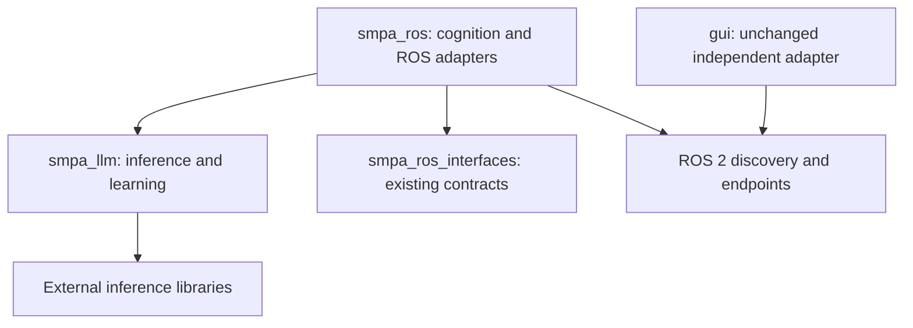

# Inference package migration

Branch: `feature/llm-reorganization`, based on `89462f4`.

## Responsibilities and dependencies

The robot keeps its explicit Sense → Model → Plan → Act execution in `smpa.py`.
Four independent stage nodes share the serialized `smpa_llm` inference server. Conversation keeps its independent Sense → Model
→ Act execution and existing Markdown/RDF persistence. Existing ROS contracts
remain available alongside the approved cognitive action definitions.

| Owner | Responsibilities | Dependencies |
| --- | --- | --- |
| `smpa_ros` | Explicit experiment script, independent cognitive nodes, sensory ROS adapters, conversation, beliefs, provenance | `smpa_llm`, interfaces, ROS, external action servers |
| `smpa_llm` | Backend implementations, generation controls, model registry/provisioning, specialized inference, offline training | Inference libraries; training uses its separate environment |
| `smpa_ros_interfaces` | Existing services and actions only | ROS interface generators |
| `gui` | Existing independent browser presentation and ROS adapter | Unchanged by this migration |



## Sequence and rollback

Each phase is a separate commit. Roll back a phase by reverting its commit on
this feature branch; retain existing model weights and experiment data unchanged.
Do not reset a source branch or migrate historical records.

1. **Package boundary.** Move root cognitive metadata into `smpa_ros/`, and its
   Python implementation into `smpa_ros/smpa_ros/`. Keep `memory`, `sense`
   and `speech` public imports and installed executable names. Update installer,
   colcon test paths, source-path assertions and installed-resource tests. Verify
   automatic discovery, three-package build, imports, resources and unit tests.
   No runtime performance effect is expected from metadata relocation.
2. **Generic inference.** Move `backends` implementations into
   `smpa_llm/smpa_llm/inference/backends/`. Keep stage generation and fixed action
   schema validation in cognition. Move conversational generation validation to
   inference; preserve old module identity for dependency injection. Verify
   strict schemas, all providers, roles, reasoning metadata and model sharing.
   Imports add no model load, process or serialization.
3. **Model management.** Move registry YAML and provisioning implementation to
   the shared package. Extract selection and asset verification from cognitive
   Model. Preserve lazy loading, revisions, weight paths and downloader commands.
   Verify manifests, model discovery, downloader failure recovery and installed
   registry lookup. Do not move or download existing large weights.
4. **Specialized inference.** Move speech engines and segmentation inference to
   the shared package, retaining ROS adapters, cancellation, service names and
   independent evaluator lifecycles. Verify speech shutdown, segmentation and
   VisualJEV, including injected devices. Do not insert evaluators into the loop.
5. **Training.** Move the gym implementation under shared training ownership.
   Preserve the launcher, separate environment, worker lifecycle, approval gates,
   immutable feedback, SFT/DPO and checkpoint formats. Run the real RLHF suite.
6. **Configuration and launch.** Give cognitive and inference parameters one
   owner each, resolve installed defaults with ament resources and preserve
   legacy overrides. Verify launch arguments, source and installed commands,
   model paths and independent gym execution. No inference node is introduced.
7. **Documentation and verification.** Update existing usage documentation,
   run unit/integration/RLHF suites and installed checks, inspect whitespace,
   record skips and actual latency/memory measurements. Confirm main and GUI
   remain unchanged. The next milestone is a shared inference ROS node and its
   services/actions; it is outside this migration.

## Baseline limitation

Before moving inference implementations, unit tests passed (328 passed, two
optional skips), and RLHF passed (12 tests). The all-senses integration test
exceeded its existing 360-second deadline twice during Model generation after
successful Sense persistence. The other three integration tests passed. The
second run was serial. This is an unresolved baseline failure, not a verified
migration regression. Logs are outside the repository in
`/tmp/smpa-llm-step1/`. No timeout or assertion was weakened.

## Implemented layout and compatibility

All three ROS packages are siblings and discoverable with
`colcon list --base-paths .`. There is no root ROS package metadata.

```text
smpa_ros/                       Cognitive ROS package
  package.xml, setup.py, config.yaml, launch/
  smpa_ros/                     Cognitive Python implementation
  memory.py, sense/, speech/
smpa_llm/                       Inference/training ROS package
  package.xml, setup.py, config.yaml, models/, requirements-*.txt
  smpa_llm/
    configuration.py
    inference/{backends/,speech.py,segmentation.py,conversation.py}
    models/{loading.py,provision.py}
    training/rlhf/{app.py,inference.py,training.py,vault.py}
smpa_ros_interfaces/            Unchanged generated contracts
gui/                            Unchanged presentation
models/                         Existing weight storage; YAML compatibility links
```

Root `memory.py`, `sense/`, `speech/`, and `launch/` retain source
compatibility links. Legacy `smpa_ros.backends.*` and `speech.backends` imports
alias the actual shared modules, so monkeypatches affect the same objects.
Cognitive `smpa_ros.model` re-exports shared selection helpers, retaining its own
world-model construction, prompts and persistence. No inference implementation
imports cognition. The two historical backend logger names remain unchanged.

The legacy installed `share/smpa_ros/models/` registry is generated from the same
source as `share/smpa_llm/models/`. It is a compatibility resource, not a second
editable model registry. Existing source registry and downloader paths are links.
Weights, reports, revisions, model IDs, checkpoints and run formats have not moved.

The root `rlhf_gym` imports alias canonical gym modules. The original Streamlit
file path links to the canonical app. Workers retain their explicitly approved
subprocess lifecycle and interpreter; their internal module name is now
`smpa_llm.training.rlhf.training`. Normal inference does not import training.

## Configuration ownership and precedence

- `smpa_ros/config.yaml`: camera, sensing, goal, stages, prompts, execution and
  conversation defaults.
- `smpa_llm/config.yaml`: shared model selection and provider settings.
- `smpa_ros_interfaces`: no configuration file.
- Root `config.yaml`: preserved complete legacy configuration for existing
  launch/configurator commands. It is read directly, rather than implicitly
  merging defaults into historical configurations.

For package-owned defaults, the cognitive YAML explicitly selects
`inference_config: package://smpa_llm/config.yaml`. Ament resolves that resource;
no installed source-tree path is assumed. An external inference YAML can instead
be selected by a path relative to the selected cognitive file. Explicit values
in that cognitive file replace entire top-level sections. No recursive merge is
introduced. The selector is removed from the effective pipeline so persisted
snapshots keep the existing format. Existing stage override resolution and CLI
modality/cycle overrides then retain their original precedence.

Installed resources are read-only defaults. Save writable overrides outside the
installation and select them using existing `--config` / `config:=` arguments.
Credentials remain in environment variables or an external dotenv file.

## Commands

From `<workspace>/src/smpa-ros`, after the existing installation prerequisites:

```bash
./install.sh
source /opt/ros/jazzy/setup.bash
source ../../install/setup.bash
colcon list --base-paths .
ros2 launch smpa_ros llm.launch.py --show-args
ros2 run smpa_llm download_models --list
.venv/bin/python scripts/download_models.py --list --model-root "$PWD/models"
./run_smpa.sh max_cycles:=1
./run_smpa.sh --all-senses /absolute/conversation/run \
  config:="$PWD/config/sense_observe.yaml" max_cycles:=1
./run_rlhf.sh
./test.sh --unit
./test.sh --integration
./test.sh --rlhf
```

Robot launch commands require the documented external camera/action environment;
the default robot profile can move the simulated head. Verification in this
migration uses only fixture devices and the Observe-only profile. Source Python
cognitive commands require sourcing the built overlay. Training still uses its
separate `.venv-rlhf`, or an explicit `RLHF_PYTHON` override.

No dependency versions were upgraded for this migration. Existing runtime pins
moved to their owning package/profile. Installer constraints combine both package
metadata declarations; source provisioning receives the two checkout package
roots before colcon installation, so it does not require a previous SMPA install.
Training retains its separate Transformers/PEFT/TRL dependency profile.

## Verification record

| Phase | Commit | Verification |
| --- | --- | --- |
| Package boundary | `c15333d` | 3 packages built; 328 unit tests passed, 2 optional skips; installed checks passed |
| Generic inference | `4848852` | 330 unit tests passed, 2 optional skips; 9 installer tests passed; installed checks passed |
| Model management | `fcca4f0` | 330 unit tests passed, 2 optional skips; provisioning/registry and installed checks passed |
| Specialized inference | `c7157e3` | 330 unit tests passed, 2 optional skips; speech/cancellation and segmentation checks included |
| Training | `6fa34ab` | 12 RLHF tests passed, including real SFT/DPO and worker cancellation; 330 unit tests passed, 2 optional skips |
| Configuration | `7daffbb` | 331 unit tests passed, 2 optional skips; canonical/legacy defaults and installed checks passed |

The default full integration run after migration produced **3 passed, 1 failed**
in 511.17 seconds. The all-senses production-launch test exceeded its unchanged
360-second subprocess deadline during Model generation, reproducing the baseline
failure. Sense had already persisted Vision, Hear and Read evidence. Interrupting
the active generation required SIGTERM escalation; this is not a successful
normal-shutdown result. The other actual model, speech and VisualJEV integration
tests passed. No test timeout or assertion was weakened.

Final logs and fixture artifacts are outside Git:
`/tmp/smpa-llm-final-integration.log`, `/tmp/smpa-llm-final-acceptance/`.
The feature worktree is `/tmp/smpa-llm-workspace/src/smpa-ros`; the original
shorter worktree path was moved so the existing launcher’s workspace-layout
preflight can run unchanged.

Optional browser verification requires `SMPA_BROWSER_TEST=1` and Firefox.
Optional actual Qwen3-4B conversation comparison requires `SMPA_QWEN_TEST=1` and
its registered weights; that model is unavailable here. Live API-provider calls,
physical robot operation and a complete network installation into a new cognitive
environment were not performed. Existing environments were reused without pip
changes; package builds and installed-resource checks use isolated overlays.
The training suite reported CUDA unavailable, so training validation was CPU only.

### Performance observations

The default final fixture run loaded the VLM exactly once. Its vision inference
completed in **34.95 seconds**, within the baseline’s approximately 30–37-second
range. A live GPU sample showed approximately **4.4 GiB** used; later process
sampling showed **4556 MiB** for the single VLM process. Its sampled host RSS was
approximately **3.44 GiB**, with 46 threads. These are samples, not peak-memory
or throughput measurements. Model-stage latency exceeded the existing test
budget, so a completed cycle latency cannot be reported for the default run.

A read-only source model inventory completed in **0.10 seconds**, with peak RSS
**20,540 KiB**. This measures registry/asset listing, not model inference.
Packaging and direct Python delegation introduce no new model instances,
processes or ROS serialization; their latency cost has not been separately
benchmarked. A separate run with explicit `OMP_NUM_THREADS=4 MKL_NUM_THREADS=4` also
exceeded the unchanged Model-stage deadline. Its vision stage took 43.37 seconds,
so this experiment did not demonstrate a performance improvement. No production
concurrency defaults or test deadlines were changed.

### Preserved branches and limitations

`main` remains `89462f42d152226ba2fb062374869172aa8ed743`; the GUI branch remains
`296a96d3036b071435d3f86c032bdc5b8f40c868`. GUI files and ROS interface definitions
have no diff from the base. Fifteen critical relocated assets/contracts, including
requirements, registry YAML, persistence, planning, actions, beliefs and the robot
loop, were checked byte-for-byte against the base. Final implementation narrative
changes were also checked for identical AST after stripping docstrings.

A failed registry-isolation test created
`smpa_ros/models/download_report.json`. Automatic review rejected deletion as
potentially destructive. It remains untracked, deliberately excluded from every
migration commit. Existing model files and unrelated work were retained.

Full acceptance remains conditional on the unresolved default all-senses timeout.
The next architectural milestone is **a shared inference ROS node and its
services/actions**. It is not implemented in this branch.

### Final real conversational check

The available Qwen3-0.6B checkpoint was exercised offline through the installed
`smpa_llm` backend, from `/tmp`, with a three-message
User/Assistant/User history. With thinking disabled and a 32-token budget it
returned **CEDAR**, the code word in the earlier turns. This was CPU inference
with an explicitly selected two-thread test setting, not a production change.
Load time was **7.12 seconds**, generation **2.14 seconds**, and peak RSS
**2,422,044 KiB** (about 2.31 GiB). One model was loaded. This does not validate
the unavailable default conversational Qwen3-4B checkpoint.

The four-thread full integration comparison also ended **3 passed, 1 failed**
in 526.43 seconds. Its failure was again the unchanged all-senses deadline during
Model generation. Logs are `/tmp/smpa-llm-thread4-integration.log` and
`/tmp/smpa-llm-thread4-acceptance/`; the short local conversation log is
`/tmp/smpa-llm-local-conversation.log`. No performance setting was committed.

### Final unit, training and installation checks

Final unit verification: **332 passed, 2 skipped, 4 integration tests deselected**
in 65.17 seconds. All three packages built and installed successfully; external
imports, resources, existing entry points, new provisioning entry point, launch
argument checks and the seven focused package-boundary regressions passed.
Final RLHF verification: **12 passed** in 47.47 seconds. Warnings were the existing
PEFT Conv1D adjustment and pytest cache permissions; the unit suite also reports
an existing Pillow deprecation. Setuptools reports the existing deprecated
`tests_require` metadata option during package builds.

The installer's required-dependency graph and inference API checks passed against
the existing environment. Its generated constraints were reconstructed in a
temporary directory, since this reused development environment does not contain
that installer-generated file. No constraints, pip configuration or packages were
written into the cognitive environment. The selected installed versions include
Torch 2.14.1, Transformers 5.20.0, Outlines 1.3.3, OpenAI 3.39.0, PEFT 0.21.0,
Accelerate 1.15.0 and RDFLib 7.1.4; existing declaration bounds/pins were retained.
The separate RLHF profile retains its incompatible pinned versions unchanged.

Shell syntax and cumulative Git whitespace checks passed. All tracked
compatibility links resolve. Process inspection after both failed integration
runs found **zero remaining all-senses fixture processes**. This does not turn
the forced-shutdown failures into successful normal shutdown tests.

Exact final-suite reproduction in this local feature worktree:

```bash
cd /tmp/smpa-llm-workspace/src/smpa-ros
./test.sh --unit
SMPA_ACCEPTANCE_OUTPUT=/tmp/smpa-llm-recheck ./test.sh --integration
RLHF_PYTHON=/home/dorteel/ros2_ws/src/smpa-ros/.venv-rlhf/bin/python ./test.sh --rlhf
bash -n install.sh test.sh run_smpa.sh run_rlhf.sh
git diff 89462f4 --check
```

The integration command is expected to reproduce the outstanding Model timeout
on this machine. To repeat the diagnostic profile, explicitly prefix it with
`OMP_NUM_THREADS=4 MKL_NUM_THREADS=4`; this also timed out, so it is not a fix.
Logs are `/tmp/smpa-llm-final-unit.log`, `/tmp/smpa-llm-final-rlhf.log`, and
`/tmp/smpa-llm-final-dependencies.log`.

Actual local constrained generation also passed with Qwen3-0.6B on CPU: the
returned JSON satisfied the unchanged `action_schema(['observe'])` and selected
Observe, in 12.58 seconds. Optional schema-permitted fields were present. An
initial ad-hoc smoke assertion incorrectly required the minimal object alone;
the corrected check validates the original schema and selected action instead.
No repository assertion or backend validation was weakened. Schema validity does
not establish semantic accuracy, and no action was dispatched. Logs are
`/tmp/smpa-llm-local-plan.log` (initial harness assertion) and
`/tmp/smpa-llm-local-plan-verified.log` (passing schema check).
